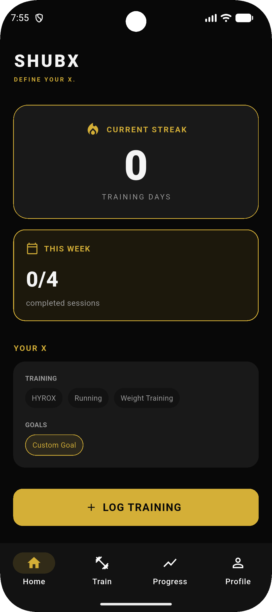
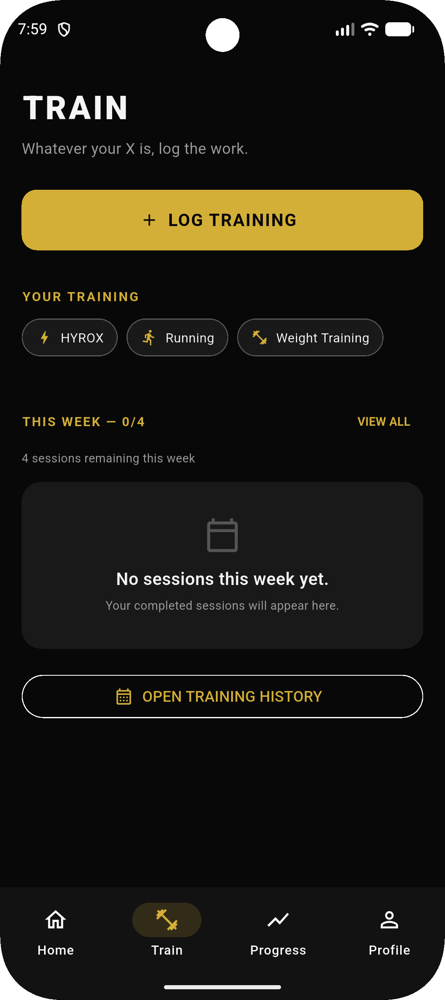
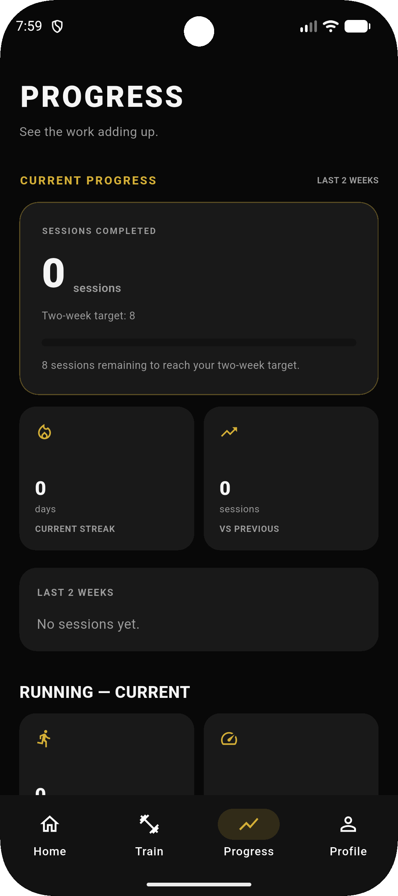
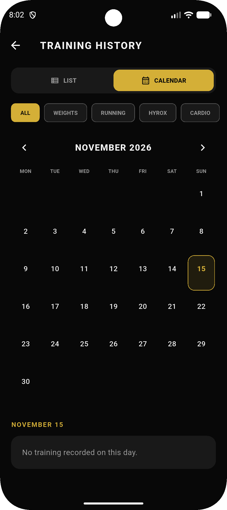
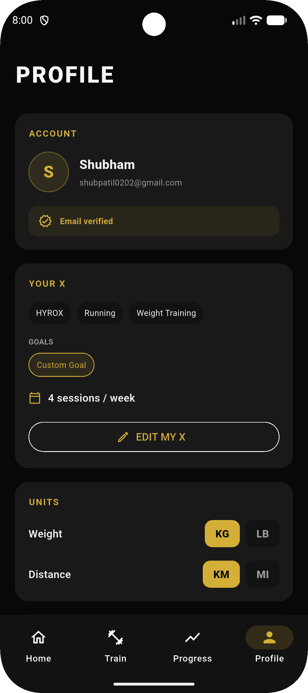

# SHUBX

<p align="center">
  <strong>DEFINE YOUR X.</strong>
</p>

<p align="center">
  A personalized multi-discipline fitness tracking application built with Flutter.
</p>

<p align="center">
  
</p>

---

## About SHUBX

**SHUBX** is an Android fitness tracking application built around one idea:

> **Your training should adapt to your goals — not the other way around.**

Instead of forcing every user into the same workout structure, SHUBX allows users to **Define Their X** by selecting the training styles, goals, and weekly frequency that matter to them.

The app brings **strength training, running, walking, cardio, and HYROX training** into one unified system for logging workouts, tracking history, and measuring progress.

---

## App Preview

<p align="center">
  
  &nbsp;&nbsp;
  
  &nbsp;&nbsp;
  
</p>

<p align="center">
  <strong>Home &nbsp;&nbsp;&nbsp;&nbsp;&nbsp;&nbsp; Training &nbsp;&nbsp;&nbsp;&nbsp;&nbsp;&nbsp; Progress</strong>
</p>

<br>

<p align="center">
  
  &nbsp;&nbsp;
  
  &nbsp;&nbsp;
  
</p>

<p align="center">
  <strong>History &nbsp;&nbsp;&nbsp;&nbsp;&nbsp;&nbsp; Profile &nbsp;&nbsp;&nbsp;&nbsp;&nbsp;&nbsp; Authentication</strong>
</p>

---

## Key Features

- Personalized **Define Your X** training setup
- Weight training with sets, reps, weight, and exercise tracking
- Running with automatic pace calculations
- Walking with personalized estimated step count
- Multi-activity cardio tracking
- Dedicated HYROX Full Simulation logger
- Custom HYROX training sessions
- Calendar-based workout history
- Detailed workout views
- Edit and delete completed workouts
- Current and all-time progress analytics
- Training streak tracking
- kg / lb and km / mi support
- Firebase account authentication
- Email verification and password recovery
- Cloud backup and restore
- Offline-first local workout storage

---

## Define Your X

SHUBX allows each user to build their own training identity.

Users can configure:

- Training disciplines
- Fitness goals
- Weekly session target
- Weight units — kg / lb
- Distance units — km / mi
- Height and weight

Training preferences can be changed later without recreating the account.

---

## Weight Training

SHUBX supports structured resistance-training sessions with:

- Muscle-group based exercise selection
- Exercise library
- Sets and repetitions
- Weight tracking
- Duration-based exercises
- Distance-based exercises
- kg and lb support
- Workout editing and deletion
- Total training volume analytics

---

## Running

Running sessions support:

- Distance
- Duration
- Automatic pace calculation
- Kilometer and mile support
- Historical run tracking
- Total running distance
- Best pace
- Recent pace comparison
- Editable sessions

---

## Walking

Walking sessions include:

- Distance
- Duration
- Pace
- km / mi support
- Estimated step count
- Height-based personalized step estimation
- Historical walking statistics

---

## Cardio

SHUBX supports multiple cardio activities, including:

- Cycling
- Rowing
- SkiErg
- StairMaster
- Elliptical
- Swimming
- Hiking
- Jump Rope
- Other cardio activities

Metrics adapt to the selected activity and can include distance, duration, pace, speed, floors, repetitions, and rounds.

---

## HYROX Training

SHUBX includes dedicated HYROX functionality instead of treating HYROX as generic cardio.

### Full Simulation

A full simulation tracks:

- 8 × 1 km runs
- SkiErg
- Sled Push
- Sled Pull
- Burpee Broad Jumps
- Rowing
- Farmers Carry
- Sandbag Lunges
- Wall Balls

SHUBX calculates:

- Overall simulation time
- Total running time
- Total station time
- Fastest run
- Slowest run
- Individual station splits
- Best station performances

### Custom HYROX Training

Users can also build custom HYROX sessions by:

- Adding runs and stations
- Reordering segments
- Removing segments
- Recording individual segment times
- Editing completed sessions

---

## Training History

Every completed session becomes part of the user's training history.

SHUBX provides:

- Calendar-based workout history
- Detailed workout views
- Activity-specific metrics
- Edit Workout
- Delete Workout

Editing a workout updates the existing record instead of creating a duplicate history entry.

---

## Progress Analytics

The Progress system separates recent performance from long-term development.

### Current Progress

Based on the most recent two weeks:

- Sessions completed
- Target completion
- Current streak
- Comparison with the previous two weeks
- Training-type breakdown
- Recent running distance
- Average running pace
- Pace improvement

### Overall Progress

All-time analytics include:

- Total workouts
- Total training time
- Longest streak
- Training distribution
- Total running distance
- Best running pace
- Weight-training volume
- Total sets
- HYROX sessions
- Best full simulation
- Best HYROX station times
- Walking distance
- Estimated steps

Progress is calculated directly from the workout database, so edited and deleted sessions are reflected in the analytics.

---

## Authentication

SHUBX uses **Firebase Authentication** for account management.

Supported functionality includes:

- Create Account
- Email/password Sign In
- Persistent authentication
- Email verification
- Forgot Password
- Password reset
- Sign Out

---

## Cloud Backup & Restore

SHUBX uses **Cloud Firestore** to provide account-based backup and restoration.

Cloud backups can preserve:

- Training preferences
- Fitness goals
- Weekly target
- Profile preferences
- Workout history
- Weight-training exercises and sets
- Running sessions
- Walking sessions
- Cardio sessions
- HYROX full simulations
- HYROX custom training sessions

SQLite remains the primary local workout database, allowing SHUBX to operate locally while Firestore provides cloud backup and restoration.

---

## Architecture

```text
                         SHUBX
                           |
            +--------------+--------------+
            |                             |
         Flutter                       Firebase
            |                             |
     +------+-------+             +-------+--------+
     |              |             |                |
   UI Layer      Services    Authentication     Firestore
                    |
             +------+------+
             |             |
          SQLite     SharedPreferences
             |             |
             +------+------+
                    |
               Training Data
```

### Local-First Data Layer

Workout operations are stored locally using SQLite.

This provides:

- Fast reads and writes
- Offline operation
- Relational workout storage
- Foreign-key relationships
- Reliable workout editing
- Cascading workout deletion

### Cloud Layer

Firebase provides:

- Account authentication
- User identity
- Email verification
- Password recovery
- Cloud backup
- Cloud restoration

---

## Tech Stack

| Technology | Purpose |
| --- | --- |
| **Flutter** | Android application framework |
| **Dart** | Application language |
| **SQLite / sqflite** | Relational local workout database |
| **SharedPreferences** | Local preferences and onboarding state |
| **Firebase Authentication** | Account creation and authentication |
| **Cloud Firestore** | Cloud backup and restoration |
| **Material Design** | UI foundation |
| **Git / GitHub** | Version control and source hosting |

---

## Database Design

SHUBX uses a relational SQLite database with specialized tables for different training structures.

```text
workouts
|
+-- workout_exercises
|      |
|      +-- exercise_sets
|
+-- walking_sessions
|
+-- running_sessions
|
+-- cardio_sessions
|
+-- hyrox_sessions
|      |
|      +-- hyrox_splits
|
+-- hyrox_training_sessions
       |
       +-- hyrox_training_segments
```

Foreign-key relationships and cascading deletion help maintain data consistency when workouts are edited or removed.

---

## Project Structure

```text
lib/
|
+-- app/
|   +-- app.dart
|   +-- theme.dart
|
+-- data/
|   +-- exercise_library.dart
|
+-- models/
|   +-- cardio_session.dart
|   +-- exercise.dart
|   +-- exercise_set.dart
|   +-- hyrox_session.dart
|   +-- hyrox_training_session.dart
|   +-- progress_analytics.dart
|   +-- running_session.dart
|   +-- user_preferences.dart
|   +-- walking_session.dart
|   +-- workout.dart
|   +-- workout_exercise.dart
|
+-- screens/
|   +-- auth/
|   +-- home/
|   +-- main/
|   +-- onboarding/
|   +-- profile/
|   +-- progress/
|   +-- splash/
|   +-- training/
|
+-- services/
|   +-- auth_service.dart
|   +-- cloud_sync_service.dart
|   +-- database_service.dart
|   +-- preferences_service.dart
|   +-- progress_service.dart
|
+-- widgets/
|
+-- firebase_options.dart
+-- main.dart
```

---

## Getting Started

### Requirements

Install:

- Flutter
- Dart
- Android Studio
- Android SDK
- Git

Verify the Flutter environment:

```bash
flutter doctor
```

### Clone the Repository

```bash
git clone https://github.com/shubhpatil27/SHUBX.git
cd SHUBX
```

### Install Dependencies

```bash
flutter pub get
```

### Firebase Configuration

SHUBX uses Firebase Authentication and Cloud Firestore.

Configure your own Firebase project using FlutterFire:

```bash
dart pub global activate flutterfire_cli
flutterfire configure
```

In Firebase, enable:

```text
Authentication
+-- Email/Password

Firestore Database
+-- Production Mode
```

Firestore security rules should restrict each user's data to their authenticated Firebase UID.

### Run SHUBX

Connect an Android device or start an Android emulator:

```bash
flutter devices
flutter run
```

---

## Design

SHUBX uses a minimal dark visual system built around:

- Black backgrounds
- Charcoal surfaces
- Gold accents
- High-contrast typography
- Minimal navigation
- Performance-focused information hierarchy

The goal is to keep the interface focused on training rather than visual clutter.

---

## Engineering Highlights

Some of the core engineering work behind SHUBX includes:

- Multi-discipline workout modeling
- Relational SQLite database design
- Foreign-key and cascading-delete relationships
- Activity-specific workout loggers
- Dynamic workout metrics
- Pace and speed calculations
- Height-based walking step estimation
- Training volume calculations
- HYROX split tracking
- Custom ordered HYROX segments
- Calendar-based workout history
- Universal workout editing and deletion
- Two-week and all-time analytics
- Firebase Authentication integration
- Password recovery and email verification
- Local-first data persistence
- Firestore cloud backup and restoration
- User-specific cloud security rules

---

## Philosophy

**SHUBX** comes from the idea that fitness does not have one universal definition.

For one person, **X** might be strength.

For another, it might be running.

For another, HYROX.

For another, simply becoming more consistent.

SHUBX does not define that goal for the user.

It gives them the tools to:

> ### DEFINE YOUR X.

---

## Version

**SHUBX v1.0.0**

Initial complete release featuring multi-discipline training tracking, HYROX support, progress analytics, Firebase authentication, and cloud backup.

---

## Author

**Shubham Suryakant Patil**

GitHub: [@shubhpatil27](https://github.com/shubhpatil27)

---

### SHUBX — DEFINE YOUR X.
